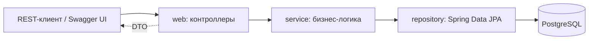

# CourseHub

Учебная платформа: курсы, модули, уроки, домашние задания, тесты и отзывы.

Серверная часть на Spring Boot и Hibernate. Проект покрывает полный цикл работы с ORM:
проектирование модели данных, связи один-к-одному, один-ко-многим и многие-ко-многим,
ленивую загрузку и способы её обхода, репозитории Spring Data JPA, бизнес-логику,
REST API и интеграционные тесты.

## Стек

- Java 21, Maven
- Spring Boot 3.5, Spring Web, Spring Data JPA, Hibernate
- PostgreSQL 16
- Bean Validation, Lombok
- springdoc-openapi
- JUnit 5, Mockito, H2 для тестов
- Docker, Docker Compose, GitHub Actions
- JaCoCo, Spotless, Enforcer

## Архитектура



Слои:

- `web` - контроллеры, обработка ошибок, OpenAPI
- `service` - транзакции, бизнес-правила, загрузка графов сущностей
- `repository` - Spring Data JPA, JPQL, EntityGraph
- `entity` - 17 сущностей JPA и перечисления
- `dto`, `mapper` - модели запросов и ответов, явный маппинг
- `seed` - демонстрационные данные

Подробнее: [docs/architecture.md](docs/architecture.md), [docs/database.md](docs/database.md), [docs/api.md](docs/api.md).

## Быстрый старт

Нужен только Docker.

```bash
docker compose up --build
```

Приложение поднимется на `http://localhost:8080`, база - в контейнере `coursehub-db`.
При первом запуске схема создаётся автоматически и заполняется демо-данными.

- Swagger UI: http://localhost:8080/swagger-ui/index.html
- OpenAPI JSON: http://localhost:8080/v3/api-docs
- Health: http://localhost:8080/actuator/health

Остановить:

```bash
docker compose down
```

## Локальный запуск

Нужны JDK 21, Maven 3.9+ и PostgreSQL (или только контейнер с базой).

```bash
cp .env.example .env
docker compose up -d db
mvn spring-boot:run
```

По умолчанию активен профиль `dev`: база `jdbc:postgresql://localhost:5432/coursehub`,
пользователь и пароль `coursehub`, параметры переопределяются переменными
`DB_URL`, `DB_USERNAME`, `DB_PASSWORD`.

## Демо-данные

Профиль `dev` включает `DemoDataInitializer` (свойство `coursehub.demo.enabled`).
Если таблица пользователей пуста, создаются:

| Роль | Имя | Email |
|---|---|---|
| ADMIN | Администратор | admin@coursehub.example |
| TEACHER | Иван Петров | ivan@coursehub.example |
| TEACHER | Мария Соколова | maria@coursehub.example |
| STUDENT | Анна Смирнова | anna@coursehub.example |
| STUDENT | Пётр Кузнецов | petr@coursehub.example |
| STUDENT | Ольга Иванова | olga@coursehub.example |

Дальше создаются три категории, три курса с модулями и уроками, два задания,
квиз из двух вопросов, записи на курсы, проверенные решения, результат теста,
отзывы и уведомления. Паролей нет: аутентификация не входит в задание.

Чтобы запустить с пустой базой, уберите `coursehub.demo.enabled` или задайте `false`.

## API

Базовый путь `/api`. Полное описание с примерами: [docs/api.md](docs/api.md).

| Ресурс | Основные операции |
|---|---|
| `/api/users` | создание, чтение, обновление, удаление, профиль |
| `/api/categories` | CRUD |
| `/api/courses` | CRUD, фильтры, структура курса |
| `/api/courses/{id}/modules`, `/api/modules/*` | модули |
| `/api/modules/{id}/lessons`, `/api/lessons/*` | уроки |
| `/api/lessons/{id}/assignments`, `/api/assignments/*` | задания |
| `/api/assignments/{id}/submissions`, `/api/submissions/*` | решения и оценки |
| `/api/courses/{id}/enrollments` | запись на курс и списки |
| `/api/modules/{id}/quiz`, `/api/quizzes/*` | тесты и результаты |
| `/api/courses/{id}/reviews` | отзывы и рейтинг |
| `/api/users/{id}/notifications` | уведомления |

Ошибки возвращаются в формате `application/problem+json` (RFC 7807) с полями
`title`, `status`, `detail`, `code` и списком `errors` для ошибок валидации.

## Тесты

```bash
mvn verify
```

- 21 unit-тест сервисов на Mockito
- 21 интеграционный тест на H2 в режиме PostgreSQL: CRUD, каскады, уникальность,
  полный сценарий через MockMvc, схема, ленивая загрузка
- покрытие строк 58%, сборка падает при падении ниже 50% (JaCoCo)

Интеграционные тесты используют отдельный профиль `test` и не требуют Docker.

## Структура проекта

```
src/main/java/ru/alexey/coursehub
├── config        OpenAPI
├── dto
│   ├── request   входные модели с валидацией
│   └── response  модели ответов
├── entity        17 сущностей JPA, перечисления
├── exception     доменные исключения и коды
├── mapper        явный маппинг сущностей в DTO
├── repository    Spring Data JPA
├── seed          демонстрационные данные
├── service       интерфейсы и реализации бизнес-логики
└── web           REST-контроллеры, обработка ошибок
```

## Работа с ORM

- все коллекции и связи `@ManyToOne`, `@OneToOne` объявлены `LAZY`;
- `spring.jpa.open-in-view` выключен, поэтому ленивые данные загружаются осознанно;
- списки и детали читаются через `join fetch` и `@EntityGraph`, чтобы не ловить N+1;
- тест `LazyLoadingIT` воспроизводит `LazyInitializationException` и показывает обход;
- схема создаётся Hibernate (`ddl-auto: update` в `dev`, `create-drop` в тестах),
  причины выбора описаны в [ADR 001](docs/adr/001-ddl-auto.md);
- H2 в тестах вместо PostgreSQL обоснован в [ADR 002](docs/adr/002-h2-in-tests.md).

## Ограничения

- нет аутентификации и авторизации: роли хранятся и проверяются в бизнес-логике,
  но HTTP-доступ не ограничен, это допускается заданием;
- нет файлового хранилища: решение задания хранится текстом;
- демо-данные создаются только в пустой базе.
