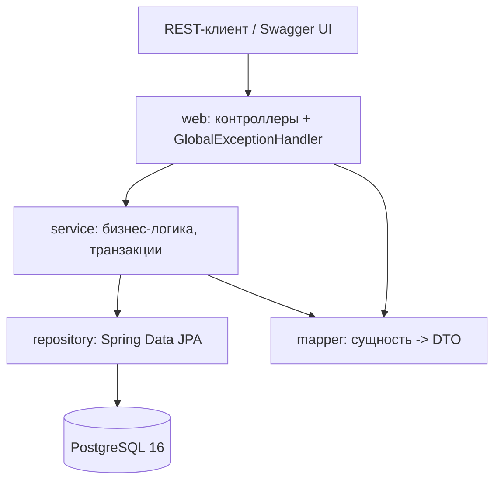
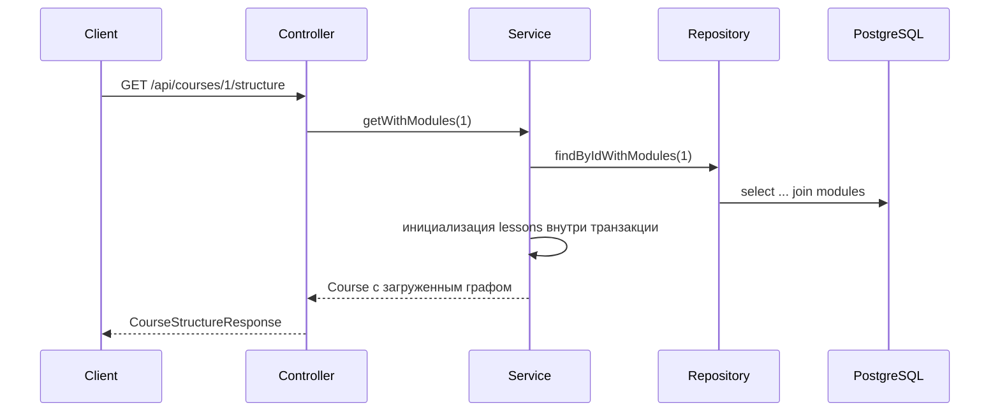
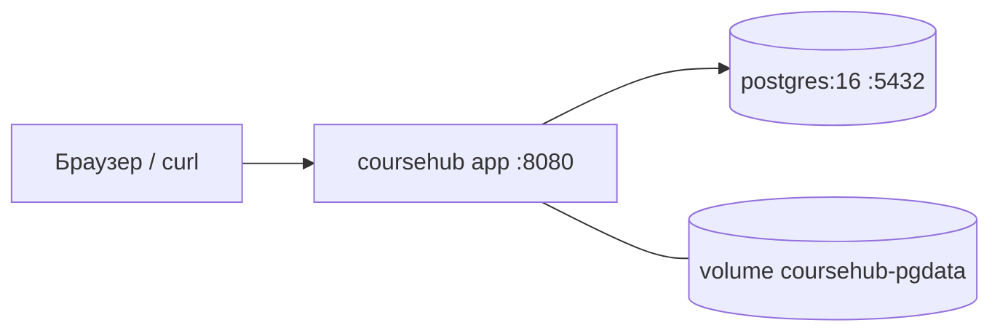

# Архитектура CourseHub

## 1. Компоненты

Приложение - монолит на Spring Boot. Микросервисы здесь не нужны: предмет задания - ORM,
а не распределённые транзакции, поэтому один процесс и одна база дают более простую
и проверяемую модель.

## 2. Слои и ответственность

| Слой | Пакет | Что делает |
|---|---|---|
| Web | `web` | HTTP, коды ответов, параметры пагинации, OpenAPI, единый формат ошибок |
| Service | `service`, `service.impl` | бизнес-правила, границы транзакций, загрузка нужных графов сущностей |
| Repository | `repository` | Spring Data JPA, производные запросы, JPQL, `@EntityGraph` |
| Domain | `entity` | 17 сущностей JPA, перечисления, каскады |
| Transport | `dto`, `mapper` | входные модели с валидацией, модели ответов, явный маппинг |
| Bootstrap | `seed` | демонстрационные данные в пустой базе |

Правила, которые соблюдаются в коде:

- сущности не выходят за пределы сервисного слоя, наружу отдаются DTO;
- контроллеры не знают о `EntityManager` и не открывают транзакции;
- маппинг не обращается к незагруженным связям: DTO собираются из того, что сервис
  гарантированно инициализировал внутри транзакции.

## 3. Путь запроса

## 4. Транзакции и ленивая загрузка

- `spring.jpa.open-in-view=false`: сессия закрывается вместе с сервисным методом.
- Все коллекции и связи объявлены `LAZY`.
- Чтение списков идёт через `@EntityGraph` или `join fetch`, чтобы не порождать N+1.
- Для вложенных коллекций используется `default_batch_fetch_size=32` и явная
  инициализация внутри транзакции.
- `LazyLoadingIT` фиксирует оба поведения: исключение вне транзакции и успешную
  работу после `join fetch`.

## 5. Обработка ошибок

`GlobalExceptionHandler` возвращает `application/problem+json`:

| Ситуация | Статус | `code` |
|---|---|---|
| доменное исключение | 404 / 409 / 400 | `NOT_FOUND`, `CONFLICT`, `BAD_REQUEST` |
| ошибка валидации DTO | 400 | `VALIDATION_ERROR` + список `errors` |
| нарушение ограничения БД | 409 | `DATA_CONFLICT` |
| необработанная ошибка | 500 | `INTERNAL_ERROR` |

## 6. Решения и компромиссы

- **Монолит, а не микросервисы.** Проще проверять, меньше инфраструктуры, вся модель в одном месте.
- **DTO вместо сериализации сущностей.** Убирает циклические ссылки и утечку ленивых полей.
- **Явные мапперы вместо MapStruct.** Вложенные структуры всё равно собираются вручную,
  а явный код проще читать и отлаживать.
- **H2 в интеграционных тестах.** Проверяющему не нужен Docker, см. ADR 002.
- **Схема из сущностей, а не Flyway.** Требуется по заданию, см. ADR 001.

## 7. Диаграмма развёртывания

